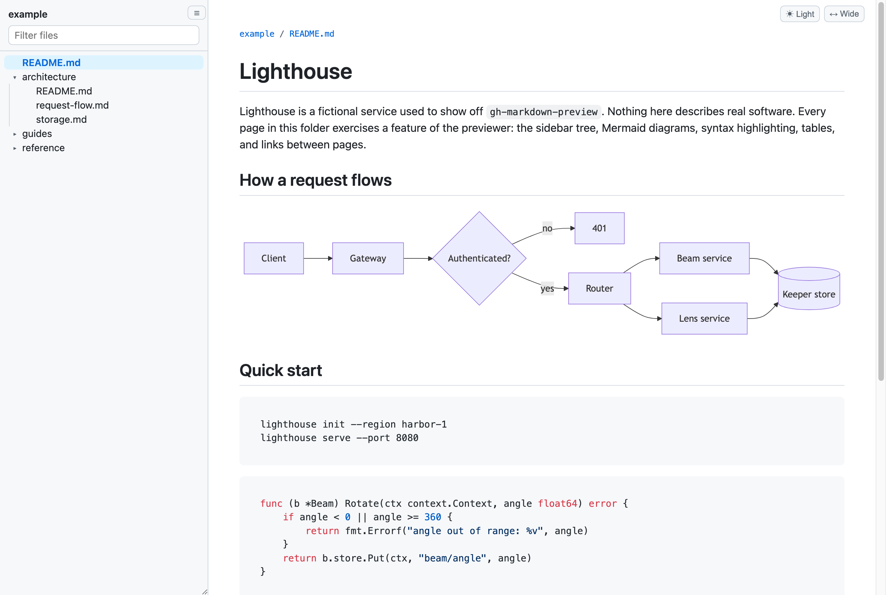
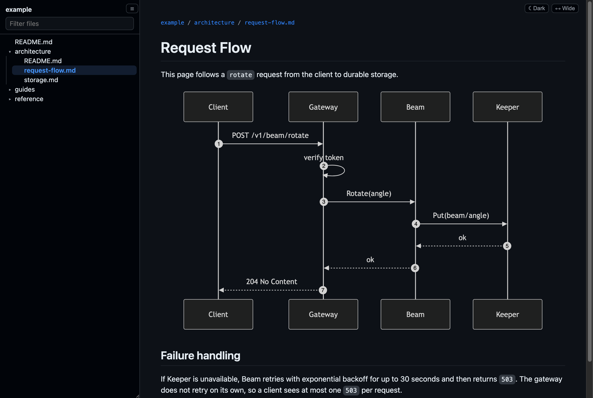

# gh-markdown-preview

Preview a folder of markdown locally, the way GitHub would render it: GitHub's styling, Mermaid diagrams, syntax highlighting, a file tree, and live reload. It's one Python file with no dependencies beyond the standard library.





The pages above come from [`example/`](example/README.md), a small fictional docs set kept in this repo for trying the previewer out.

## Setup

Clone the repo somewhere and alias the script. The rest of this README assumes the alias.

```sh
git clone <this repo> ~/code/gh-markdown-preview
echo "alias mdp=~/code/gh-markdown-preview/preview.py" >> ~/.zshrc
```

Python 3.9 or newer is all it needs. Rendering happens in the browser with `marked`, `github-markdown-css`, `highlight.js`, and `mermaid`, pinned and loaded from jsDelivr, so the browser needs network access.

## Usage

```sh
mdp                          # preview the current directory
mdp docs/architecture.md     # open one file
mdp docs/                    # open the folder's README or index, or a listing if it has neither
mdp ~/code/gh-markdown-preview/example   # the example docs
mdp . --port 6500 --no-open  # fixed port, don't open the browser
mdp docs/ --feedback         # collect comments for an agent (see below)
```

The served root defaults to the git toplevel of the path, so links that climb out of the folder you opened (`../other.md`) still resolve and the tree shows the whole repo. Pass `--root DIR` to serve something narrower or wider.

Each run listens on a port the OS picks, so several previews can run side by side; the URL is printed at startup and opened in your browser. Pass `--port` to pin one.

## Features

- **GitHub rendering.** `github-markdown-css` styles, GitHub-flavored markdown (tables, task lists, strikethrough), and heading anchors with GitHub's IDs, so links like `page.md#some-heading` land where they would on GitHub.
- **Mermaid.** Fenced `mermaid` blocks render as diagrams, in a theme that matches the page. A diagram that fails to parse shows the error and its source in place.
- **Syntax highlighting** with `highlight.js` and GitHub's light and dark themes.
- **File tree.** A sidebar lists every markdown file under the root. Each folder shows its README or index first, then subfolders, then files. The current file is highlighted and its folders open. In a git repo the tree comes from `git ls-files`, so ignored files stay out. Anywhere else it walks the directory and skips hidden folders, `node_modules`, `vendor`, and build output.
- **Filter.** Type in the box above the tree to narrow it to matching paths. Enter opens the first match.
- **Theme.** Cycle between auto (follows the system), light, and dark.
- **Wide mode.** Drops GitHub's 1012px content width cap, which helps with wide tables and diagrams.
- **Live reload.** The page checks for changes every second and re-renders in place, keeping your scroll position. A folder listing page also picks up added or removed files. The sidebar tree refreshes on the next page load.
- **Remembered layout.** Theme, wide mode, sidebar width, and whether the sidebar is hidden persist across pages and runs. Open folders and the sidebar's scroll position are remembered per served root. They're saved in `~/.config/gh-markdown-preview/prefs.json` (or under `$XDG_CONFIG_HOME`), not in browser storage, because browser storage is tied to the port and the port changes every run.

## Feedback for an agent

`mdp --feedback` turns the preview into a review tool for a coding agent such as Claude Code. You comment on the rendered page, the agent edits the markdown, and live reload shows the result.

- **Comment.** Select text and press `c` (or click **Comment**), or hover a block and click the **+** in the left margin to comment on the whole block.
- **Diagrams.** In a Mermaid diagram, click a node, an edge label, a subgraph title, or a sequence diagram message, then press `c` or click **Comment**. Selecting text inside a label does the same. The comment attaches to that label and glows on the diagram, and the agent gets the label text along with the diagram's source. The **+** still comments on the whole diagram.
- **Drafts.** Comments start as drafts, like a pending GitHub review. Once there are drafts, a widget in the lower right offers **Submit feedback**, which sends every draft under the root as one batch.
- **Threads.** The comments panel (`c` with nothing selected, or the 💬 button) lists the page's threads. The agent's replies appear there, and you reply in the same thread. You resolve threads; the agent never does.
- **Agent status.** The widget and panel show whether an agent is listening, working on a batch, or absent. Submitting with no agent listening is fine: the batch waits for one.
- **Outdated comments.** A comment stays attached to its text through edits that move it. If the quoted text itself is gone, usually because the agent reworded it, the thread is marked outdated and stays in the panel.

The agent's side is a subcommand:

```sh
preview.py feedback wait --root ROOT       # block until you submit, claim the batch, print it
preview.py feedback reply --root ROOT 7 "Reworded it."
preview.py feedback show --root ROOT       # open threads
preview.py feedback roots                  # roots with feedback, and whether an agent is listening
```

`wait` prints each thread's file, line range, quoted text, the source lines as they were when you commented, and the conversation so far, followed by the commands to reply and to wait again. An agent runs `wait` in the background, makes the edits when it exits, replies, and starts the next `wait`. ROOT defaults to the git toplevel of the current directory, and the server prints the exact command at startup.

Comments live in a sqlite database per served root, under `~/.config/gh-markdown-preview/feedback/`, so separate worktrees keep separate threads and resolved threads stay on record.

## Keyboard

| Key | Does |
|---|---|
| `/` | Focus the file filter |
| `Enter` (in the filter) | Open the first match |
| `Esc` (in the filter) | Clear the filter |
| `\` | Show or hide the sidebar |
| `t` | Cycle the theme: auto, light, dark |
| `w` | Toggle wide mode |
| `c` | With `--feedback`: comment on the selection, or show or hide the comments panel |
| `⌘↵` / `Ctrl+↵` (in a comment) | Save the comment |

Drag the sidebar's lower-right corner to resize it.

## Security

The server binds to 127.0.0.1 and refuses any path outside the served root. It serves other files under the root as-is, so images and other assets referenced by your markdown load normally.

With `--feedback`, an agent acts on whatever lands in the comment database, so the feedback endpoints only accept requests that carry a token the server generates at startup and embeds in its own pages, and only on a `127.0.0.1` or `localhost` Host header. Other sites open in your browser can't read the token or set the header, so they can't post comments, and DNS rebinding doesn't get past the Host check.

## Differences from GitHub

- No GitHub alerts (`> [!NOTE]`), footnotes, or emoji shortcodes.
- No math rendering.
- Relative links resolve against the local file tree, not against a branch on github.com.
