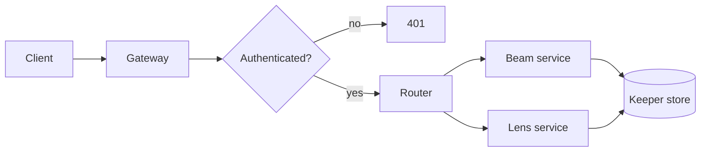

# Lighthouse

Lighthouse is a fictional service used to show off `gh-markdown-preview`. Nothing here describes real software. Every page in this folder exercises a feature of the previewer: the sidebar tree, Mermaid diagrams, syntax highlighting, tables, and links between pages.

## How a request flows



## Quick start

```sh
lighthouse init --region harbor-1
lighthouse serve --port 8080
```

```go
func (b *Beam) Rotate(ctx context.Context, angle float64) error {
	if angle < 0 || angle >= 360 {
		return fmt.Errorf("angle out of range: %v", angle)
	}
	return b.store.Put(ctx, "beam/angle", angle)
}
```

## Services

| Service | Owns | Default port |
|---|---|---|
| Gateway | TLS, auth, rate limits | 8080 |
| Beam | Rotation schedule | 9001 |
| Lens | Brightness and fog mode | 9002 |
| Keeper | Durable state | 9100 |

## Pages

- [Architecture](./architecture/README.md), including the [request flow](./architecture/request-flow.md) sequence diagram.
- [Getting started](./guides/getting-started.md) and [configuration](./guides/configuration.md).
- [CLI reference](./reference/cli.md).
