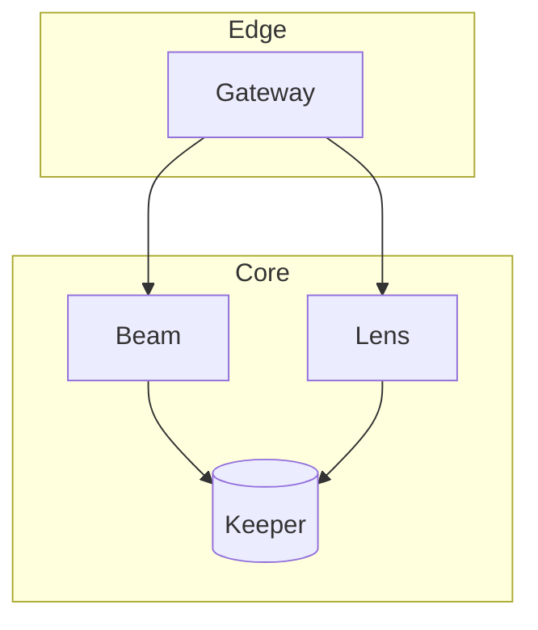

# Architecture

Lighthouse has one stateless edge tier and one stateful core. The edge accepts requests and the core decides what the light does.

- [Request flow](./request-flow.md) walks one request through every service.
- [Storage](./storage.md) covers how Keeper persists state.

