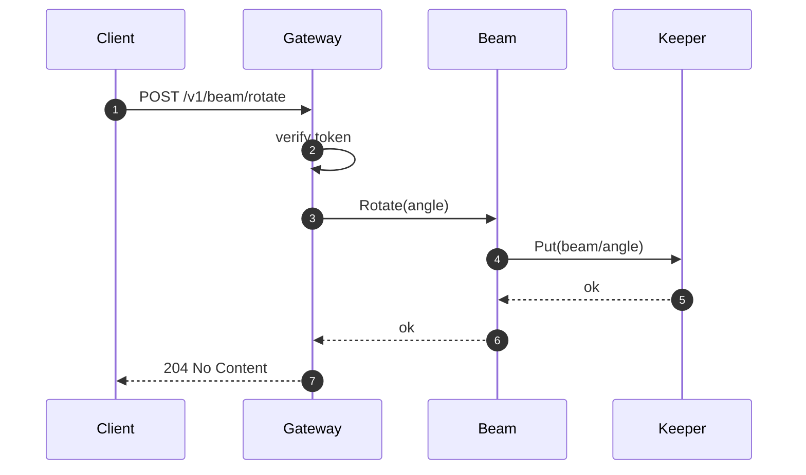

# Request Flow

This page follows a `rotate` request from the client to durable storage.

## Failure handling

If Keeper is unavailable, Beam retries with exponential backoff for up to 30 seconds and then returns `503`. The gateway does not retry on its own, so a client sees at most one `503` per request.

See [Storage](./storage.md#write-path) for what Keeper does with the write.
